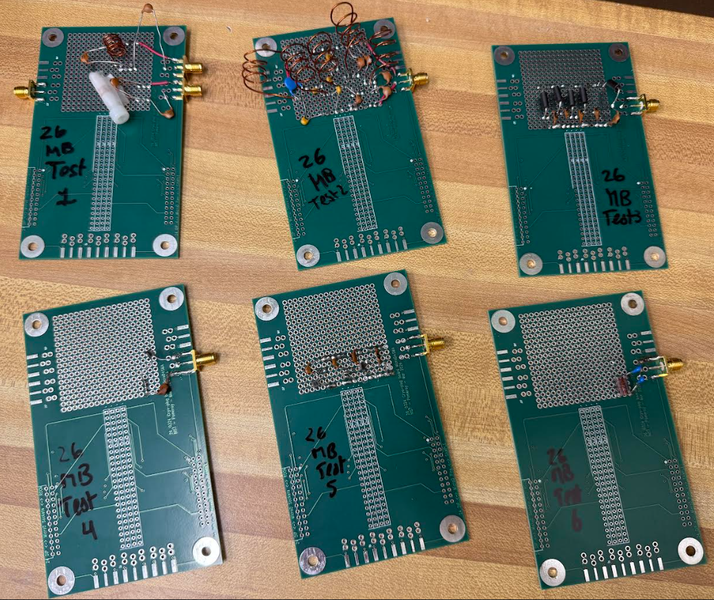
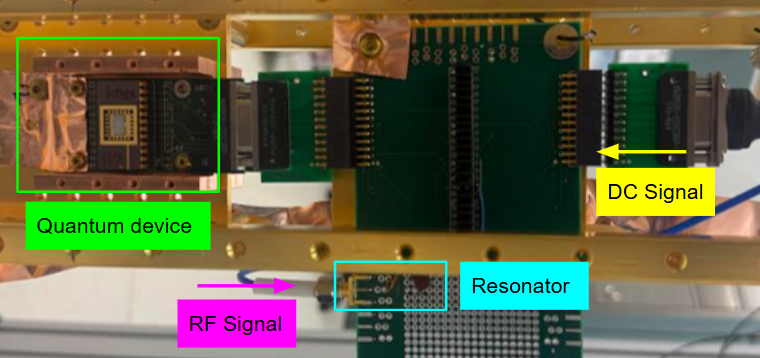
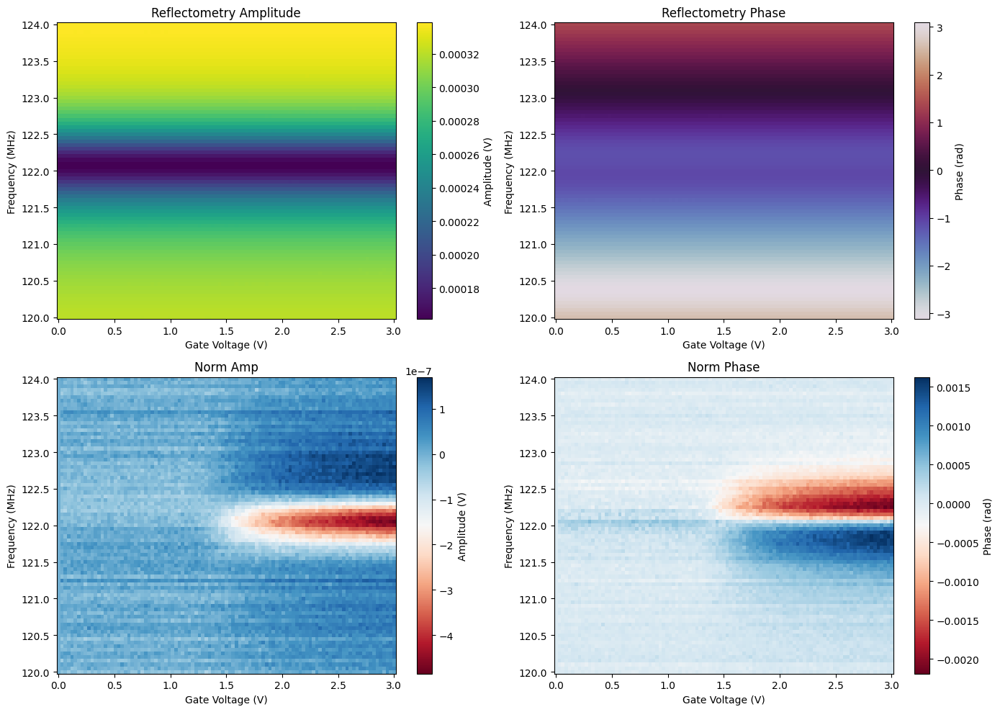

# Cryogenic RF Reflectometry

**Myriam Bajani | NIST SURF Internship | Summer 2026**  
Atom Scale Device Group, Physical Measurement Laboratory

I designed, built, and tested an LC resonator readout circuit to detect small capacitance changes in a semiconductor quantum device. The project combined LTspice modeling, RF hardware testing, and measurements at **10 mK**.

### My work

- Modeled the resonator in LTspice and refined the model to account for coupling and parasitic capacitance.
- Built and tested resonator circuits, then reproduced PNA measurements using an OPX and directional coupler.
- Designed a bias tee to combine RF readout and DC bias, and integrated the circuit with the quantum device and cryostat wiring.
- Measured reflected amplitude and phase as a function of frequency and gate voltage, using background normalization to reveal the device response.

### Results

- Verified resonator operation near **122 MHz at 10 mK**.
- Detected device turn-on near **1.5 V** and measured an effective capacitance change of approximately **0.21 fF** over a **0–2 V** gate sweep.
- Achieved signal-to-noise ratios of approximately **10 in amplitude** and **8 in phase**, after extended averaging.

The measurements detected electron accumulation, but did not resolve individual electron transitions. Future work focused on improving sensitivity with a low-noise amplifier and reducing averaging time.

*Cryogenic integration of the resonator, RF input, DC bias, and quantum device.*

*Background normalization reveals the device response near resonance.*

**Tools and methods:** LTspice, PNA measurements, OPX, RF reflectometry, bias tee design, cryogenic characterization.

This portfolio summary uses selected figures and results from my August 4, 2026 SURF presentation. It documents my internship work within the NIST research group. Measurement code, raw data, and editable design files are not included.
